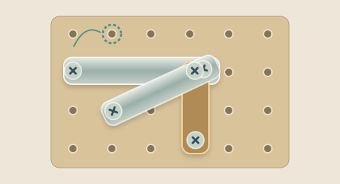
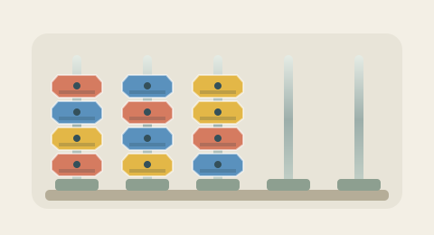
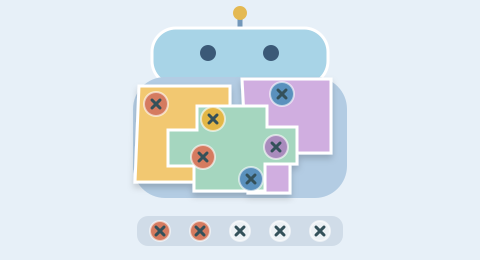
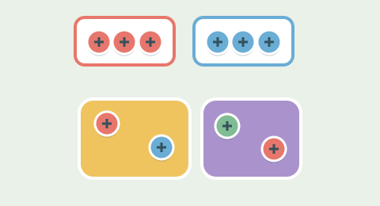
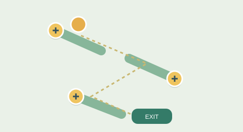

# Screw Games

**拧动一颗螺丝，换一种思路。**

[Screw Games](https://screw.games/) 是一个专注螺丝益智玩法的浏览器游戏合集。无需下载即可开始，在电脑或手机上体验拆解、分类、配色、空间观察与路线规划。

## 六款游戏，六种思考方式

| 游戏 | 玩法 |
| --- | --- |
| [Screw Puzzle](https://screw.games/games/screw-puzzle/) | 移动螺丝、改变支撑，让板条逐步松开并落下。 |
| [Screw Sort](https://screw.games/games/screw-sort/) | 在杆之间移动顶端螺母，把混合颜色整理成同色堆叠。 |
| [Screw Jam](https://screw.games/games/screw-jam/) | 拆开彩色结构，收集三个同色螺丝，同时为暂存区留出空间。 |
| [Screw Box](https://screw.games/games/screw-box/) | 按当前颜色订单装满收集盒，安排下一步取出哪些螺丝。 |
| [Screw 3D](https://screw.games/games/screw-3d/) | 旋转立体模型，观察不同表面，找出可拆解的螺丝与面板。 |
| [Screw Escape](https://screw.games/games/screw-escape/) | 移除支撑、调整斜坡，引导小球收集钥匙并到达出口。 |

以上图片为玩法插画，并非游戏实机截图。

## 每款两关，从理解规则到挑战自己

- **第一关：教学入门。** 在简洁的局面中理解这款游戏的核心操作。
- **第二关：专家挑战。** 面对更多层次、颜色或路线约束，仔细规划每一步。
- **按自己的节奏思考。** 没有倒计时催促；可以重试相同布局，或换一个新布局。
- **遇到困难时使用辅助。** 提示、撤销和救援各有用途；具体效果与可用次数在游戏内说明。

第二关以高难度为设计方向，尚无经过真人统计验证的固定通过率。

## 轻松开始，逐步掌握

游客可以直接免费练习。六款游戏使用不同的封面与操作图标，支持电脑和手机布局；页面提供独立玩法介绍、操作图解、攻略与常见问题。

网站还提供安装到桌面或主屏幕的入口，具体方式取决于设备和浏览器支持。

账户体系包含连续签到、通关积分以及积分兑换道具和外观。规则为第一关通关奖励 2 积分、第二关奖励 10 积分；游客练习不产生账户积分。**当前真实登录与在线账户服务仍待接入验收，不能将本地练习当作已经到账的个人积分。**

## 找到适合你的玩法

- [浏览全部游戏](https://screw.games/games/)
- [了解如何游玩](https://screw.games/guides/how-to-play/)
- [阅读图文攻略](https://screw.games/guides/)

## 关于与联系

联系邮箱：[marlonqiu2027@gmail.com](mailto:marlonqiu2027@gmail.com)

[About Us](https://screw.games/about/) · [Privacy Policy](https://screw.games/privacy-policy/) · [Contact](https://screw.games/contact/) · [Terms of Service](https://screw.games/terms/)
